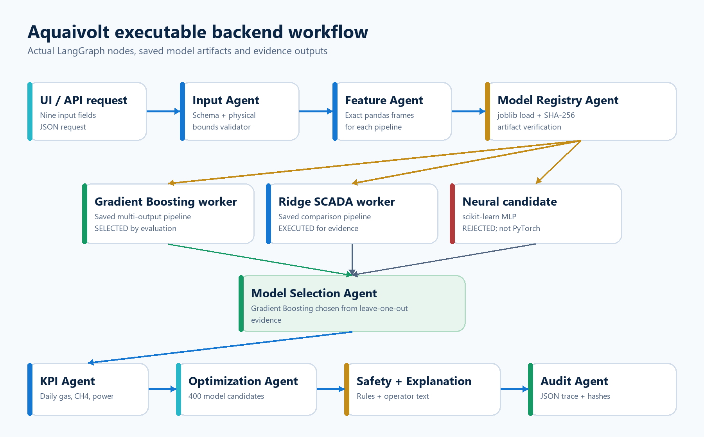

# Aquaivolt AI Biogas Command Center

[](https://github.com/Rohit45-0/Biogas-prod/actions/workflows/verify-ai-workflow.yml)

This repository contains the Aquaivolt biogas dashboard, its server-side prediction logic, the executable LangGraph technical proof, saved machine-learning artifacts, model evaluation results and audit evidence.

**Live dashboard:** [aquaivolt-command-center.vercel.app](https://aquaivolt-command-center.vercel.app/)

**Client installation guide:** [Run the current dashboard locally](CLIENT_QUICK_START.md). Start here for Windows installation, local account setup, Audit Trail checks and troubleshooting.

**Current audit instructions and architecture:** [Audit Trail 1.8.0](docs/AUDIT_TRAIL.md). Earlier diagrams and presentations describe historical versions and should not be treated as a current deployment manifest.

## What happens when the user calculates production?

```text
Nine plant inputs
      ↓
Authentication and validation
      ↓
Multi-input scenario inference
      ↓
Biogas, methane, electricity and carbon calculations
      ↓
Setpoint search and recommendations
      ↓
Charts, explanation and auditable execution ID
```

The dashboard considers:

1. Feedstock type
2. Feed rate
3. Temperature
4. pH
5. Organic loading rate
6. Hydraulic retention time
7. COD input
8. VFA
9. Mixer speed

## Where is the AI/model code?

| Component | Location | Purpose |
|---|---|---|
| Deployed prediction API | [`app/api/predict/route.ts`](app/api/predict/route.ts) | Authenticated input contract and run persistence |
| Overview scenario engine | [`app/lib/model.ts`](app/lib/model.ts) | Reference-anchor inference and 2,000-candidate seeded search |
| Trained ML prediction API | [`app/api/ml/predict/route.ts`](app/api/ml/predict/route.ts) | Audit Trail: actual Ridge and Gradient Boosting predictions |
| Trained ML runtime | [`app/lib/ml-runtime.ts`](app/lib/ml-runtime.ts) | Hash-checked ONNX CPU inference using the saved fitted pipelines |
| Audit Trail | [`app/components/AuditTrail.tsx`](app/components/AuditTrail.tsx) | Execution, reproducibility, comparison and record retrieval |
| Private audit storage | [`app/lib/audit.ts`](app/lib/audit.ts) | Signed records in private Vercel Blob with readback verification |
| LangGraph workflow | [`ai-workflow/src/aquaivolt_langgraph_backend.py`](ai-workflow/src/aquaivolt_langgraph_backend.py) | Executable nine-node technical workflow |
| Saved ML artifacts | [`ai-workflow/models`](ai-workflow/models) | Gradient Boosting and Ridge pipelines |
| Model comparison | [`ai-workflow/evaluation`](ai-workflow/evaluation) | Evaluation results and limitations |
| Reproducible evidence | `ai-workflow/run-evidence/latest_run.json` (generated when the Python workflow runs) | Inputs, outputs, node trace and model hashes |
| Copilot RAG | [`app/api/copilot/route.ts`](app/api/copilot/route.ts) | Answers questions using project evidence and current scenario context |
| Technical audit guide | [`docs/AUDIT_TRAIL.md`](docs/AUDIT_TRAIL.md) | Current endpoints, model contracts and audit checks |

## LangGraph workflow

The Python workflow genuinely executes these nodes:

```text
START
  → Validate request
  → Engineer model features
  → Load and hash saved models
  → Run Gradient Boosting and Ridge
  → Select the evaluated candidate
  → Derive daily production metrics
  → Search 400 bounded operating scenarios
  → Add safety explanation
  → Persist JSON audit evidence
  → END
```



### Important implementation statement

- The **overview endpoint `/api/predict`** uses the server-side TypeScript scenario ensemble.
- The **Audit Trail endpoint `/api/ml/predict`** executes both saved Gradient Boosting and Ridge pipelines, exported to ONNX, with the fitted encoders, scalers and learned weights intact. Conversion was checked against Python predictions on 674 cases per model. No retraining or reference-engine fallback is used.
- The **LangGraph workflow** is an executable technical proof around saved scikit-learn models.
- LangGraph orchestration itself is not called by either Vercel endpoint; the trained artifacts now execute directly in the Node API through ONNX Runtime.
- PyTorch is not used. A small scikit-learn neural-network candidate was evaluated and rejected because it overfit the small supplied dataset.
- Core calculations are deterministic; each Vercel run seeds a bounded 2,000-candidate search and records the highest-scoring candidate in its audit trace. Same inputs and seed reproduce outputs.

## Run only the AI workflow on Windows

Install [Python 3.12](https://www.python.org/downloads/), download this repository and double-click:

```text
ai-workflow/RUN_AI_WORKFLOW.bat
```

The first run creates a local environment, installs the required libraries, executes the sample input and writes a new JSON file under `ai-workflow/run-evidence`.

Manual command:

```powershell
cd ai-workflow
python -m pip install -r requirements.txt
python src/aquaivolt_langgraph_backend.py --input sample_input.json --output-dir run-evidence
python tests/test_workflow.py
```

Expected reproducibility checks:

- Identical input returns identical model metrics.
- Gradient Boosting is selected from the saved comparison.
- The optimizer evaluates 400 bounded candidates.
- All nine workflow nodes appear in the trace.

## Run the dashboard locally

Follow [CLIENT_QUICK_START.md](CLIENT_QUICK_START.md). Use Node.js 24 LTS (minimum 22.13) and the pinned pnpm 11.25.0 package manager. Install the locked dependencies with:

```powershell
npm.cmd install --global pnpm@11.25.0
pnpm.cmd install --frozen-lockfile
```

Create `.env.local` from `.env.example`, generate a private session secret and replace both password placeholders. Then start the dashboard with:

```powershell
pnpm.cmd dev --webpack --hostname 127.0.0.1 --port 3000
```

After completing the first-time setup, the Windows launcher performs the same startup:

```text
START_DASHBOARD.bat
```

Configure the placeholder usernames, passwords and session secret from `.env.example` in `.env.local` before starting. No demo passwords are supplied. Local audit evidence uses the explicitly configured `AQUA_AUDIT_DIR`; production requires a linked private Blob store and its server-only `BLOB_READ_WRITE_TOKEN`.

The OpenAI API key is optional. Leave it blank for local setup. Without it, Copilot uses the built-in keyword fallback. Python is not needed to run the dashboard's exported trained models. Never commit a real password, API key or deployment token. Local passwords and local audit records are independent of the production deployment.

## Historical model evaluation

On the ten supplied optimization anchors, Gradient Boosting produced the lowest saved aggregate leave-one-out error and was retained for the technical proof. The deployed scenario ensemble remained close and is easier to explain for the prototype dashboard. Full metrics are in [`COMPARISON_REPORT.md`](ai-workflow/evaluation/COMPARISON_REPORT.md).

These archived evaluation scores have not been rerun against model version 1.8.0. The supplied workbooks are research-informed scenario and projected data, not synchronized measurements from an operating plant. They demonstrate the system but do not establish real-plant prediction accuracy. Production validation requires timestamped site measurements and an untouched test period.

## Trained ML in Audit Trail

Admin -> Audit Trail -> ML predictions. Submit explicit operating conditions to execute both trained models, export their actual predictions and signed evidence, and replay a stored run with **Verify ML run**. No OpenAI API call is required for these predictions.

- Gradient Boosting: `best_10_anchor_model.joblib`, six input features, fitted on 10 reference rows. Its targets are the reference dataset's after-AI outputs.
- Ridge: `best_scada_tabular_model.joblib`, eight input features, fitted on the 800-row training split of the SCADA template.
- Neither fitted model uses feed rate. VFA and mixer speed are used by Ridge only. Unused request values are explicitly recorded as context.
- These are different models/datasets/target definitions, not a before/after pair. A larger prediction does not identify a better model or demonstrate an optimization gain.
- Exported pipelines live in `ai-workflow/models/onnx`. Source and exported artifact hashes, feature mappings, original-Python parity checks and archived evaluation are exposed in the ML manifest. HRT is in days.
- Matching the saved Python models proves conversion fidelity, not plant accuracy. Archived Ridge R2 values are near zero or negative and should not be portrayed as strong validation.

Export reproduction and runtime tests are documented in [`ai-workflow/README.md`](ai-workflow/README.md).

## Presentation explanation

> The overview uses a reference-based scenario engine and a 2,000-candidate search. The Admin Audit Trail additionally executes the saved Ridge and Gradient Boosting pipelines at a separate ML endpoint. Both paths return explicit inputs, outputs, execution traces, model/build hashes, run IDs and confirmed storage status. Trained ML predictions and scenario optimization estimates are clearly separated. Independent plant validation remains outstanding.

## Repository map

```text
app/                 Next.js dashboard and Vercel API routes
ai-workflow/         LangGraph code, models, tests and run evidence
docs/                Architecture diagram and technical evidence document
public/              Dashboard assets
tests/               Application verification tests
```

## Safety and limitations

This is a decision-support prototype. It does not read physical sensors or automatically operate valves, mixers, heaters or generators. All recommended changes require plant-operator review.
