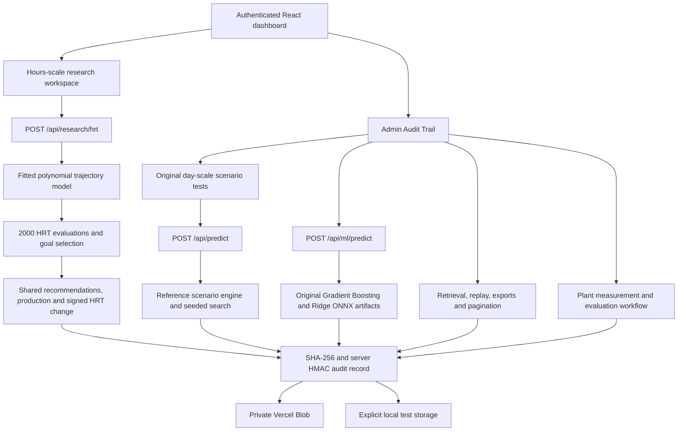

# Aquaivolt application architecture — 2 November 2026

The active application is a Next.js 16 / React 19 dashboard deployed on Vercel using Node.js 24. The main navigation, production cards, AI recommendations, reports and Copilot use the hours-scale model. The original day-scale scenario and trained-model paths remain in Admin Audit Trail for evidence and validation preparation. The 31 October audit corrections remain in place.

## Frontend and reference video

`app/page.tsx` owns authentication and the persistent navigation shell. The duplicate day-scale operational dashboard has been removed from the main navigation. The research component stays mounted while navigating between production pages and Audit Trail, so the same completed run supplies every chart, recommendation, card and export.

`app/components/HrtResearchWorkspace.tsx` provides Overview, Workbook AI reading, Biogas, Methane, Electricity, HRT in hours, Process monitor, AI optimizer, AI & KPI reports and Data sources. It reads actual backend results; it does not calculate replacement production figures in the browser. Changed settings mark the displayed result as stale until a new run finishes. Month/year totals are explicitly constant-output projections and do not change HRT. The process view reports completed backend stages without artificial progress delays.

The dashboard accepts comparison HRT in hours within 2–24 and defaults to 24 hours. The backend evaluates the comparison with the same fitted model, builds recommendation rows directly from the selected point, and saves both in the audit response and output fingerprint. The default selected HRT remains approximately 7.88 hours. These are two modelled scenarios, not measured before/after plant periods. Existing API requests containing a historical days-based comparison keep their actual conversion; comparison production is unavailable outside model coverage.

`app/components/ResearchCopilot.tsx` sends the selected saved research run ID to `/api/copilot`. The server checks Admin access and record integrity, then answers from that saved hours-scale result. It does not combine old day-scale predictions or client-supplied output numbers with current recommendations.

## Calculation paths

| Path | Inputs and model | Output meaning |
|---|---|---|
| Day-scale scenario engine | Nine process inputs; ten paired reference anchors; explicit process formulas; seeded 2,000-candidate search | Advisory scenario estimates, with feedstock reference-coverage warnings |
| Original trained ML | Gradient Boosting with six fitted features and Ridge with eight; native ONNX Runtime CPU | Gas flow, methane content and generator power from unchanged fitted artifacts; daily outputs derived explicitly |
| Hours-scale research | HRT in hours, mapped through a polynomial trajectory fitted to 500 synthetic rows | Correlated research process settings and production estimates along the supplied trajectory; no independent process effects or feedstock-specific support established |

The research model is separate because the source regimes are incompatible. The hours workbook lacks a feedstock column and jointly varies HRT, temperature, pH, feed rate and organic loading. Treating these as independently learned causal controls would overstate what the data identifies. The 0.5–5.95-hour extreme-projection workbook is inventoried but excluded from the active research model.

`ai-workflow/src/research_model_study.py` reads the original XLSX files without saving them, verifies their hashes, evaluates model candidates, and exports coefficients, source rows, evaluation results and Python parity fixtures under `ai-workflow/research/`. Its direct-XLSX and JSON-input paths were checked to reproduce the same results. No production Python service or Python model package is required for research inference: TypeScript evaluates the exported basis and coefficients.

Build fingerprints normalize TypeScript line endings so a Windows checkout and a Linux build identify the same source. JSON artifacts retain byte-level hashing. `.gitattributes` pins the archived ONNX registry's existing CRLF representation and the research JSON artifacts' LF representation; unchanged day-model fingerprints therefore remain compatible with the earlier release.

## Research request and selection

`app/lib/hrt-research.ts` owns strict request validation, coefficient evaluation, unit conversion, deterministic search and the source/model metadata. Supported objectives are:

- Shortest HRT meeting the requested share of peak modelled methane output.
- Maximum theoretical electricity potential along the same trajectory.
- A specific HRT from 2 to 24 hours, with an explicit warning if it misses the methane goal.

The 90% default methane-retention goal is an editable study criterion, not an equipment limit or validated safety threshold. A manual target can fail the goal; the interface reports that failure instead of changing the target or hiding the trade-off. The source stability index remains labelled a synthetic assumption. Prediction intervals are unavailable.

Methane volume is biogas × methane fraction. Electricity potential is methane volume × 9.97 kWh/m³ × 0.36. These are the original workbook's assumptions, not independently measured efficiencies. Volumes, gas composition, electricity and time retain separate units.

## APIs and audit evidence

| Endpoint | Behaviour |
|---|---|
| `GET /api/research/hrt` | Authenticated model/source metadata, evaluation and defaults |
| `GET /api/research/hrt?view=data` | Authenticated original synthetic rows in normalized units with Excel row numbers |
| `POST /api/research/hrt` | Admin-only research execution and persistent audit storage |
| `GET /api/research/hrt?runId=...` | Admin retrieval of an integrity-checked saved research run |
| `GET /api/research/hrt?runId=...&format=csv` | All 2,000 evaluated points from the saved result; no regeneration using a newer model |
| `POST /api/research/hrt/verify` | Admin integrity, unit and deterministic replay checks; stores a verification report |
| `/api/audit` | Existing global newest-first listing, cursor pagination, direct retrieval and authenticated JSON/CSV exports |

New records use `hrt_research` and `hrt_verification` kinds. Model coefficients, normalized source data and inference source code have distinct hashes; the research manifest binds them together. Records retain the request, units, model version, selected result, all candidate points, source hash and limitations. Old-build records remain exportable; replay rejects a mismatched current build. Storage failure returns `NOT RECORDED`, never a fabricated success.

`app/lib/audit.ts` preserves the existing readback verification and storage policy: production uses private Vercel Blob; local development/test files require an explicit audit directory and are disabled when `VERCEL` is set. Listing enumerates all storage metadata before snapshot pagination. Record integrity is checked using SHA-256 and a server-held HMAC. This is server authentication, not independent public-key verification or measurement provenance.

Authentication remains the existing eight-hour HMAC-signed session cookie and server-held Admin/User credentials. New research runs, replay and evidence retrieval require Admin; authenticated users can inspect research metadata/source rows. This release does not rotate credentials or the audit signing secret.

## Supporting systems and remaining limits

Original model cards, domain warnings, scenario execution, verification and comparisons remain available in Audit Trail and the original API routes. The Python LangGraph workflow remains a technical proof, separate from the production TypeScript request paths. The existing plant-validation workflow stores declared measured observations against saved trained-ML runs and computes errors without automatically approving validation.

The hours-scale fitted coefficients and source dataset are unchanged by the dashboard migration. Adding saved comparison points and recommendations changes the research engine fingerprint. Historical records remain downloadable without rewriting; their deterministic replay requires a matching engine build. Original day-scale model and trained-build fingerprints remain unchanged.

No PLC, detector, actuator or equipment-control connection is implemented by this work. No measurement is manufactured. Independent plant accuracy, achievable hours-scale HRT, actual production improvements and calibrated uncertainty still require commissioning, suitable measured data and review.

## Verification

The test suites cover native ONNX parity, the original audit and validation paths, new research coefficient parity, explicit units, goal selection, bounds, signed HRT increases/decreases, persistence, replay, exports and tamper rejection. Browser checks exercise shared results across the restored navigation, workbook pagination, stale-input warnings, low-HRT energy trade-offs, Audit Trail retrieval, and phone/tablet/desktop layouts. CI runs both UI suites and preserves their screenshots.

See [the empirical model study](../ai-workflow/research/MODEL_STUDY.md) for the evaluation protocol and all findings, and [the HRT research guide](HRT_RESEARCH_GUIDE.md) for use and interpretation.
